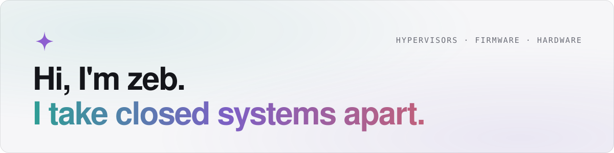

<picture>
  <source media="(prefers-color-scheme: dark)" srcset="assets/banner-dark.svg">
  
</picture>

 

I'm **zeb**. I work across the whole stack of a machine: hypervisors and kernels, firmware, graphics, and the hardware itself. Most of my projects start with something closed and end with a version I understand and control.

<table>
  <tr>
    <td>LANGUAGES</td>
    <td>Rust &nbsp;·&nbsp; C &nbsp;·&nbsp; C++ &nbsp;·&nbsp; Swift &nbsp;·&nbsp; TypeScript &nbsp;·&nbsp; GLSL / WGSL</td>
  </tr>
  <tr>
    <td>FOCUS</td>
    <td>Hypervisors &nbsp;·&nbsp; firmware &nbsp;·&nbsp; reverse engineering &nbsp;·&nbsp; graphics &nbsp;·&nbsp; electronics</td>
  </tr>
</table>

 

  <a href="https://vtl1.su">vtl1.su</a> · <a href="https://vtl1.su/training">Snapline</a>

